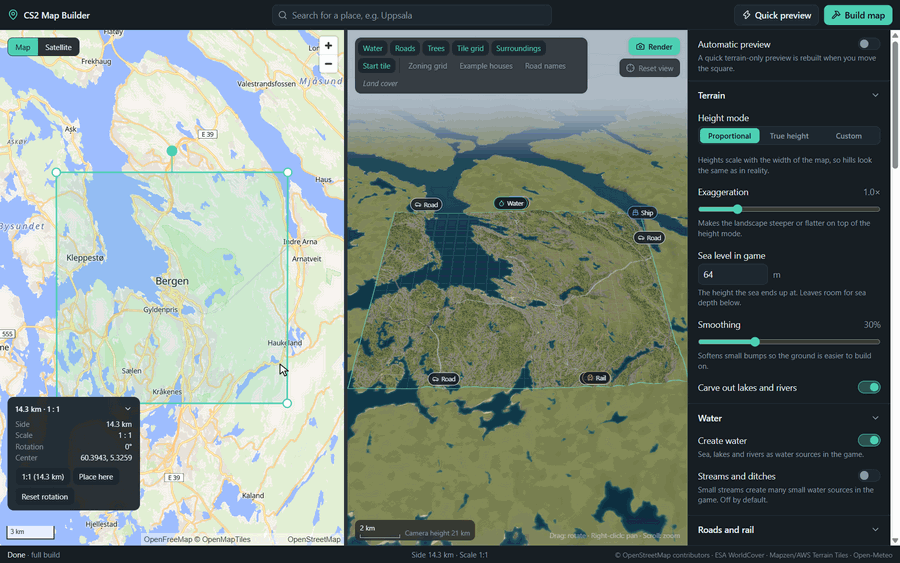
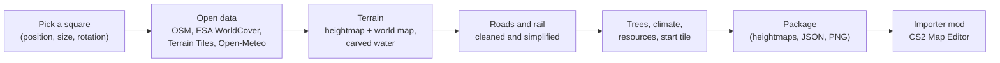
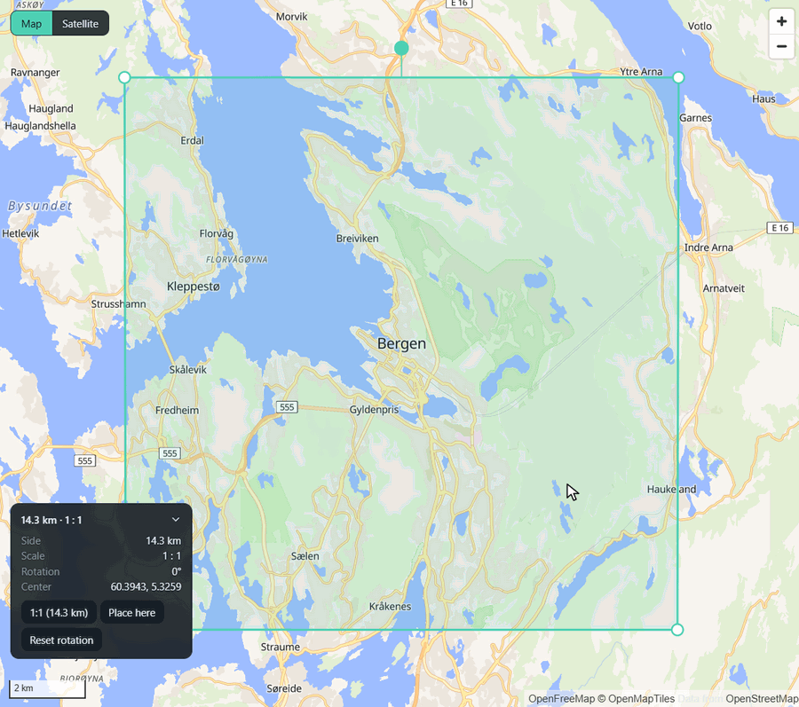
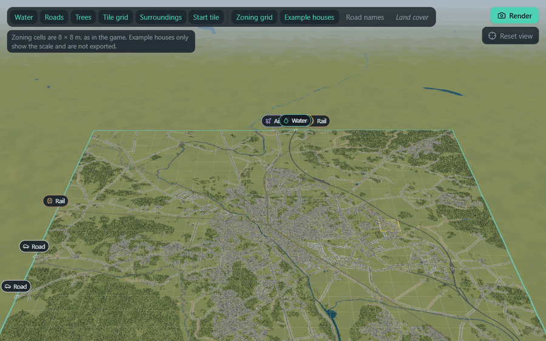
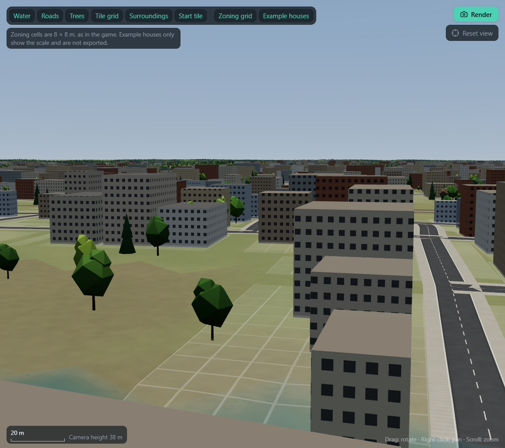
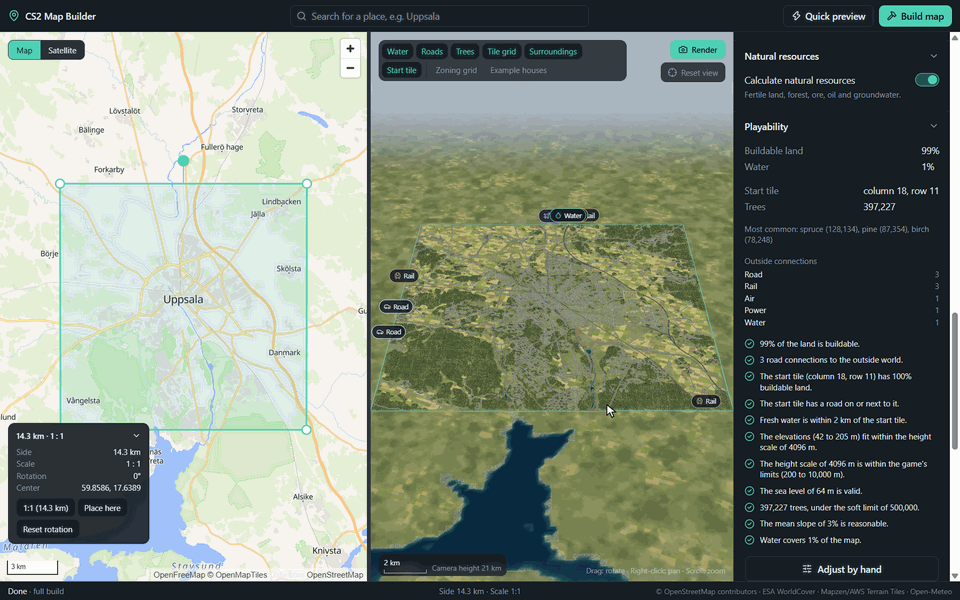
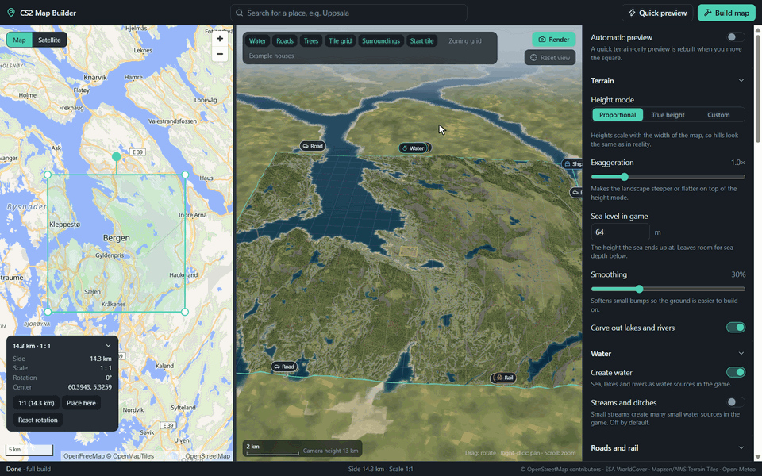
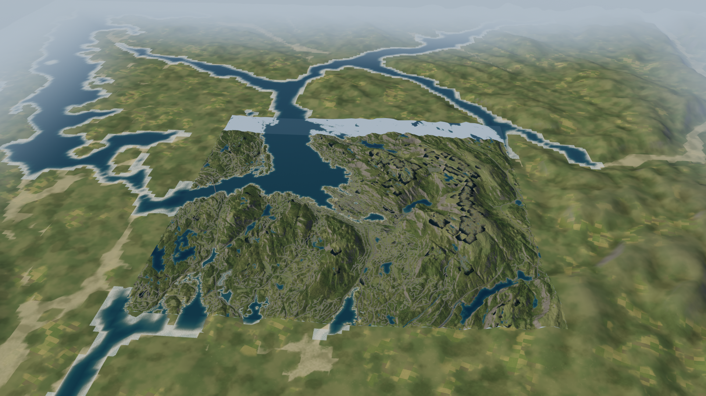
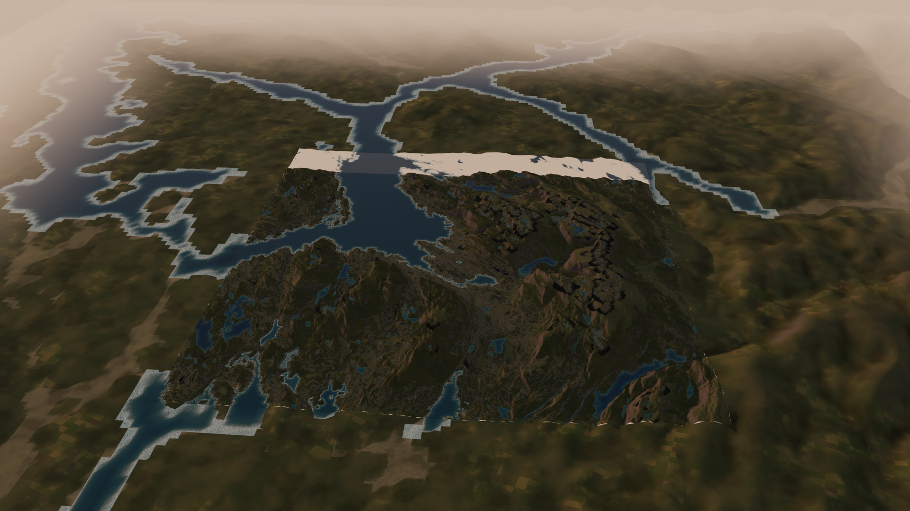

<div align="center">

# CS2 Map Builder

**Pick a square anywhere on the planet and get a playable Cities: Skylines II map of it.**

[](https://github.com/333william333/cs2-map-builder/releases/latest)
[](LICENSE)
[](#quick-start)
[](https://www.electronjs.org/)
[](https://www.typescriptlang.org/)
[](https://threejs.org/)



</div>

CS2 Map Builder turns a real place into a map for Cities: Skylines II. You mark a square on a world map, the app downloads open elevation, water, road, land cover and climate data, and computes a 16-bit heightmap, a world map, a cleaned-up road and rail network, trees by biome, climate and natural resources, all in the game's own coordinate system. Everything runs on your own computer. The internet is only needed to fetch map data.

## What it does

| | |
|---|---|
| **Real terrain** | 16-bit playable heightmap plus a world map for the surroundings, with adjustable height scaling, sea level and smoothing. |
| **Water** | Lakes, rivers and the sea are carved into the terrain and turned into water sources. |
| **Roads and rail** | The real OpenStreetMap network, cleaned up and simplified for the game, with a level-of-detail control. |
| **Trees by biome** | Forest placement from land cover, with density and a tree budget so the game stays fast. |
| **Climate and resources** | Temperature and rainfall from real data, plus fertile land, ore, oil and groundwater estimates. |
| **Start tile and connections** | Suggested start tile and outside connections (road, rail, ship, air, power, water). |
| **3D preview** | A live three.js view of the result, with a zoning grid and example houses to show real scale. |
| **High-quality render** | Render a still image of the 3D view and change the time of day. |
| **Manual editor** | A small 2D editor for playability tweaks: choose the start tile and add or remove connections. |
| **Three export levels** | A complete package for the importer mod, heightmaps only, or a tracing overlay image. |

## How it works



The build runs in a Web Worker. Data requests go through a small local caching proxy, so a second build of the same area is fast. The core pipeline (`src/core/`) is plain TypeScript with no DOM or Node dependencies, which keeps it testable.

## Quick start

### Download

1. Open the [latest release](https://github.com/333william333/cs2-map-builder/releases/latest).
2. Download either `CS2-Map-Builder-Setup-0.1.0.exe` (installer) or `CS2-Map-Builder-Portable-0.1.0.exe` (no installation, just run it).
3. Windows SmartScreen will warn that the publisher is unknown, because the build is not code signed. Choose "More info" and then "Run anyway" if you trust the download.

### Run from source

Requires Windows and [Node.js](https://nodejs.org) 20 or newer.

```powershell
git clone https://github.com/333william333/cs2-map-builder.git
cd cs2-map-builder
npm install
npm start
```

`npm start` builds the interface if needed and opens the app in Electron. Downloaded map data is cached in a `.cache` folder next to the project (or under `%APPDATA%\cs2-map-builder` in the packaged app).

## Making a map

The interface is in English. Below, the walkthrough uses Bergen, Norway as the example (Uppsala, Sweden for the street-level view).

### 1. Select an area

Search for a place or pan the world map, then place the square. Drag it to move it, drag a corner to resize it and use the round handle above it to rotate. The readout card shows the side length and scale, and the **1:1 (14.3 km)** button snaps to the exact area that is playable in Cities: Skylines II. You can make the square larger, but the map is then scaled down and the scale shown. Switch between **Map** and **Satellite** backgrounds to see what you are selecting.



### 2. Preview in 3D

With **Automatic preview** on, a quick terrain draft appears whenever you stop moving the square. Press **Quick preview** for a draft at any time, or **Build map** for a full build with roads, trees, water, climate and zoning cells. Then switch on **Zoning grid** and **Example houses** in the layer bar to judge scale: the grid shows the game's 8 by 8 metre zone cells along the roads, and the houses are placed only to show size.





### 3. Tweak playability

The settings panel on the right has sections for **Terrain** (height mode, sea level, smoothing), **Water**, **Roads and rail** (which types to include and the level of detail), **Trees** (density and budget), **Climate** and **Natural resources**. After a build, the **Playability** section lists warnings such as too little buildable land. **Adjust by hand** opens the manual editor, where you pick the **Start tile** and add outside connections (road, rail, ship, air, power, water) at the edge of the map.



### 4. Render

The **Render** button in the 3D view produces a high-quality image of the current camera view at up to 3840 by 2160. Move the time-of-day slider to relight the scene, then save the PNG.



<details>
<summary>Full-size render examples (Bergen, 1920 by 1080)</summary>





</details>

### 5. Export

In the **Export** section of the settings panel, give the map a name (the default is `MyMap`), then choose one of three levels:

| Level | What you get | When to use it |
|---|---|---|
| **Export complete map to CS2** | A package with terrain, world map, roads, trees, water, climate and resources, written to the game's mod data folder. | The convenient route. Requires the [importer mod](#the-importer-mod). |
| **Export heightmap only** | `<name>_heightmap.png` and `<name>_worldmap.png` in the game's `Heightmaps` folder, plus the values to type into the editor (mainly the height scale). | The safe route that uses only the game's own importer. You build roads and water yourself. |
| **Export reference image (Image Overlay)** | A transparent image of water, forest and roads in the game's `Overlays` folder. | Use with the free Image Overlay mod and trace by hand. |

## The importer mod

The companion mod reads a package written by the app and builds the map inside the game's **Map Editor**: terrain, world map, climate, sea level and water sources, natural resources, roads, rail and paths, street names, trees and start tiles. It has its own tab in the editor with Import, Cancel and Undo last import, plus a progress display and log.

> [!WARNING]
> **Status: not yet validated in game.** The mod compiles against Cities: Skylines II version **1.6.4f1**, but the in-game import is still being validated and may not behave as designed. Until that is confirmed, exporting heightmaps only is the safe option. The step-by-step test protocol is in [`mod/TESTING.md`](mod/TESTING.md) (English).

**Install from the release:** download `CS2MapBuilder-mod-0.1.0.zip`, unzip it and run `install.ps1` in PowerShell. It copies the mod to `%USERPROFILE%\AppData\LocalLow\Colossal Order\Cities Skylines II\Mods\CS2MapBuilder\`. Restart the game afterwards.

**Build it yourself:** you need the .NET SDK and an installed game. From the `mod/` folder run `./build.ps1` (use `-GamePath` if Steam is not in the default location), then `./install.ps1`. `./uninstall.ps1` removes it again.

Packages exported by the app are written to `%USERPROFILE%\AppData\LocalLow\Colossal Order\Cities Skylines II\ModsData\CS2MapBuilder\packages\<map name>\`. In the game, open the Editor, create a new map, open the CS2 Map Builder tab, choose the package and import. More detail is in [`mod/README.md`](mod/README.md).

## Limitations

- **Ground colours cannot be painted freely in Cities: Skylines II.** The game decides ground appearance from climate, theme and height, so a satellite image cannot be used as a ground texture.
- **No buildings are exported.** The map contains terrain, water, roads, rail, trees and resources. The houses in the preview are for scale only and are not part of any export.
- **Elevation data is about 30 m resolution** in most of the world. Small hills and steep slopes are smoothed out, especially on small maps.
- **Large areas get a thinned road network.** Minor roads are dropped so the map stays playable. The level of detail can be adjusted.
- **Some data sources can be slow.** If the Overpass service does not answer in time, the app falls back to OpenFreeMap vector tiles, with slightly less detail.
- **Internet is required** for areas that are not already in the cache.

## Roadmap

- Complete the in-game validation of the importer mod and fix what it turns up.
- Code signing for the Windows installer.
- More automatic playability checks and suggestions.
- Better handling of very large selections.

## Data sources and attribution

| Data | Source | Licence |
|---|---|---|
| Roads, water, street names | OpenStreetMap, via Overpass | ODbL 1.0, (c) OpenStreetMap contributors |
| Land cover (forest, farmland and so on) | ESA WorldCover 2021 | CC BY 4.0, (c) ESA WorldCover project, contains modified Copernicus Sentinel data (2021) processed by the ESA WorldCover consortium |
| Elevation | Terrain Tiles on AWS (Mapzen), compiled from SRTM, USGS 3DEP and other national sources | See [registry.opendata.aws/terrain-tiles](https://registry.opendata.aws/terrain-tiles/) |
| Climate | Open-Meteo | CC BY 4.0 |
| Fallback roads and water, map background | OpenFreeMap / OpenMapTiles | Data from OpenStreetMap (ODbL), OpenMapTiles (BSD, CC BY 4.0) |
| Satellite background | EOX Sentinel-2 cloudless | CC BY 4.0, (c) EOX IT Services GmbH, contains modified Copernicus Sentinel data |

**If you share a map** made with this data, for example on Steam Workshop or Paradox Mods, credit the sources in the description. At a minimum: "Contains data from OpenStreetMap (c) OpenStreetMap contributors, ODbL; ESA WorldCover 2021 (CC BY 4.0); Mapzen/AWS Terrain Tiles; Open-Meteo (CC BY 4.0)." Check each provider's current terms, as they can change.

This is a fan-made tool. It is not affiliated with, endorsed by or sponsored by Colossal Order or Paradox Interactive. Cities: Skylines is a trademark of its respective owners.

## Development

```
src/core/     pure TypeScript (no DOM/Node): data loading, terrain, roads, trees, water, export, pipeline
src/worker/   Web Worker that runs the build
src/ui/       React interface: map, 3D preview, panels
server/       small Node server: caching fetch proxy and export to disk
electron/     shell that starts the server and opens the window
scripts/      start, server bundling, packaging, smoke tests
mod/          the Cities: Skylines II importer mod (C#)
docs/         research notes and media
```

```powershell
npm run dev        # server (port 5174) and Vite (port 5173) with hot reload
npm test           # unit tests (vitest)
npm run typecheck  # TypeScript check
npm run package    # Windows build into release/
```

Architecture and the interfaces between modules are described in [`CONTRACT.md`](CONTRACT.md). The research behind the importer mod is in [`docs/MOD_SPIKE.md`](docs/MOD_SPIKE.md).

## License

[MIT](LICENSE). Map data keeps its own licences, see the table above.
